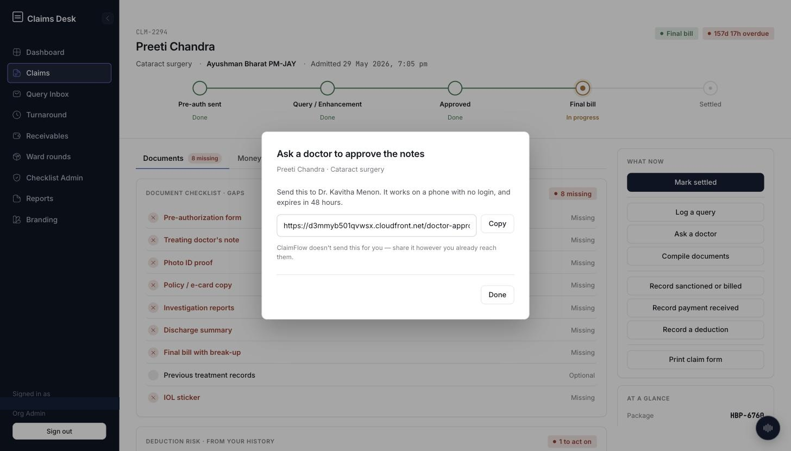
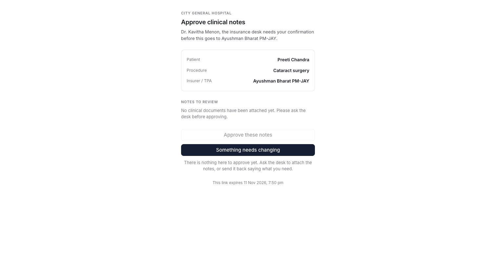
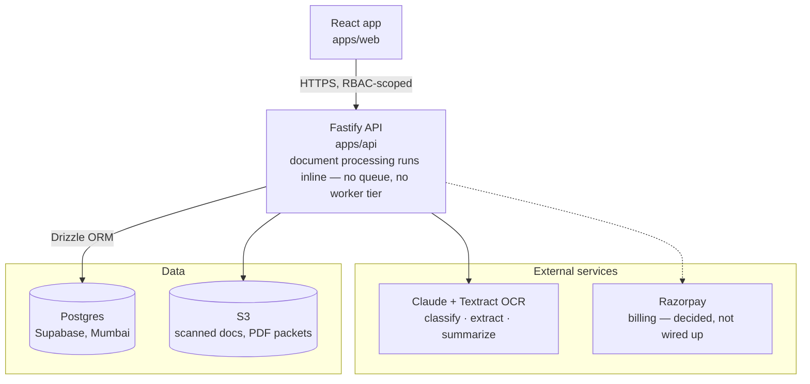

<div align="center">

# ClaimFlow

**A hospital's own insurance claims desk — one deployment per hospital.**

[](https://github.com/Cdineshreddy12/ClaimFlow/actions/workflows/ci.yml)    

[Architecture](docs/ARCHITECTURE.md) · [Decision records](docs/adr) · [Design mockup](docs/design/claims-desk-mockup.html)

</div>

---

## Quick start

```bash
git clone https://github.com/Cdineshreddy12/ClaimFlow.git
cd ClaimFlow
pnpm install
cp .env.example .env               # fill in Supabase / S3 / Anthropic keys
pnpm --filter @claimflow/api db:migrate
pnpm --filter @claimflow/api db:seed
pnpm dev                            # web → :5175, api → :4200
```

One manual step before sign-in works: enable the Supabase **Custom
Access Token** hook (Dashboard → Authentication → Hooks → select
`public.custom_access_token_hook`) — that's a dashboard toggle, not SQL,
so no migration can do it for you. Full local setup, demo data options,
deployment, and demo login details are in
[`deployment.md`](deployment.md).

## Table of contents

- [Quick start](#quick-start)
- [The problem](#the-problem)
- [What ClaimFlow does](#what-claimflow-does)
- [Screenshots](#screenshots)
- [Status](#status)
- [Architecture](#architecture)
- [Tech stack](#tech-stack)
- [Repository structure](#repository-structure)
- [Database](#database)
- [Scripts](#scripts)
- [Environment variables](#environment-variables)
- [Security model](#security-model)
- [What's not built yet](#whats-not-built-yet)
- [Documentation](#documentation)
- [License](#license)

## The problem

A hospital's insurance desk deals with cashless admissions across 20+
insurers and TPAs, and each one wants its paperwork a little differently.
In practice that means retyping the same pre-authorization details for
every insurer, scanning doctors' notes, emailing everything out, and
tracking where each claim stands in a spreadsheet. Queries from the
insurer and follow-ups with the doctor happen over email and WhatsApp,
with nobody keeping one record of who asked for what.

Most of what a hospital loses on these claims isn't bad treatment — it's
a document that wasn't there when the claim went out. And because the
desk is doing all of this by hand, patients often end up waiting longer
for discharge than the actual approval takes.

## What ClaimFlow does

- **One claim file per admission.** A live status timeline carries it
  through pre-auth, query/enhancement, approval, final bill and
  settlement, so nobody has to ask "where's this claim right now."
- **A checklist that's actually current.** Set per insurer and procedure
  by the hospital's own admin, computed fresh each time rather than
  copied off a PDF someone printed last year.
- **AI helps, but doesn't decide.** It sorts incoming documents and
  pre-fills form fields, and every suggestion shows where it came from
  and sits unconfirmed until a person clicks it. Got one wrong? Drag it
  to the right slot. Nothing reaches an insurer or TPA without a human
  in the loop.
- **A query inbox that cuts to the point.** It summarizes what a TPA is
  actually asking for and by when, with the original email sitting
  right underneath if you want to check the summary against it.
- **One hospital per install, by construction.** Earlier builds were
  multi-tenant, with an `organization_id` on every table; that was
  dropped at the client's request in favor of one deployment per
  hospital ([`adr 0002`](docs/adr/0002-authorization-and-tenant-isolation.md)).
  There's no tenant column left to filter correctly or forget — a whole
  class of cross-tenant bugs simply isn't possible in this schema.

## Screenshots

Captured from the live deployment, signed in as Org Admin, against the
seeded demo data — not mockups.

|                                                                         |                                                                         |
| ----------------------------------------------------------------------- | ----------------------------------------------------------------------- |
| **Dashboard** — KPIs, the overdue queue, and what needs attention today | **Claim File** — status timeline, document gap view, "what now" actions |
|                             |                           |
| **Claims list** — sortable, filterable, time-in-stage per claim         | **Query Inbox** — a TPA's email with the AI summary and reply countdown |
|                         |                         |
| **Turnaround** — every claim waiting on an insurer, oldest first        | **Receivables** — outstanding by age bucket and by insurer              |
|                           |                         |
| **Checklist Admin** — per insurer × procedure document rules            | **Monthly Report** — turnaround, deductions by reason, settled value    |
|                 |                                 |

Phone layout — same screens, stacked nav behind a hamburger menu:

<p>
  
  
</p>

### Claim lifecycle

The Claim File above was mid-way through (Final bill). Same screen, three
more points in the same state machine:

|                                                                                             |                                                                                                        |
| ------------------------------------------------------------------------------------------- | ------------------------------------------------------------------------------------------------------ |
| **Draft** — before pre-auth is even sent; empty timeline, "Expected cost" instead of billed | **Rejected** — its own banner and action set, with deduction risk flagged against this payer's history |
|                              |                                   |

**Settled** — the timeline closed out end to end, billed and received reconciled:


### Custom forms & modules

A hospital isn't limited to what ships in the box. Checklist Admin lets an
org admin extend both the pre-auth form and the schema itself, per
insurer, without a code change:

|                                                                                                                 |                                                                                                                   |
| --------------------------------------------------------------------------------------------------------------- | ----------------------------------------------------------------------------------------------------------------- |
| **Pre-auth form builder** — drag fields (text, date, amount, file upload…) into sections, shared or per-insurer | **Custom modules** — add a table the product doesn't ship, like a ward-round log, each with its own page and form |
|                                |                                                 |

**Ward rounds** — one such module in actual use, its own nav entry, route, and CRUD — not a mockup of the idea:


### Doctor approval by phone link

A desk mints a 48-hour, one-decision link for a named doctor with no
account — ClaimFlow doesn't send it for them, it's shared however the
desk already reaches the doctor
([`adr 0010`](docs/adr/0010-doctor-approval-links.md)):

|                                                                                                  |                                                                                                                                                            |
| ------------------------------------------------------------------------------------------------ | ---------------------------------------------------------------------------------------------------------------------------------------------------------- |
| **Desk side** — "Ask a doctor" on the Claim File mints the link and shows the expiry             | **Doctor side** — public, no login; this one honestly refuses to let the doctor approve blind, since no clinical documents were confirmed on the claim yet |
|  |                                                           |

### AI in action

Four places Claude actually runs, including what happens when it's
unsure or catches something wrong — not screenshots of a happy path only.

|                                                                                                                                      |                                                                                                                                                        |
| ------------------------------------------------------------------------------------------------------------------------------------ | ------------------------------------------------------------------------------------------------------------------------------------------------------ |
| **Desk assistant** — asked a real question, reads live claim data to answer it                                                       | **Document classification** — confidence per file, and two that got no claim match                                                                     |
|                                                        |                                                  |
| **Pre-auth consistency check** — flags a named surgery whose line of treatment doesn't match, before the desk sends it to an insurer | **Checklist rules learned from queries** — an insurer kept asking for a document the checklist didn't require; the system noticed and offers to add it |
|                             |                                                  |

## Status

**Everything below runs end-to-end against the live API, a real Supabase
Postgres database, and a real S3 bucket — not mocked, and not just styled.**

- **Auth & RBAC** — Supabase JWT verification with a Custom Access Token
  hook that stamps a role onto the token at sign-in, checked in Fastify
  middleware on every route, not just hidden in the UI. Five roles exist
  in the schema; the desk signs in as org_admin, desk_head or
  desk_executive, platform_admin has no console to use yet (see
  [What's not built yet](#whats-not-built-yet)), and doctor never gets
  an account at all — it approves through the phone link instead.
- **Claims** — one file per admission, a status timeline bound to the
  shared state machine, desk executives scoped to their own assigned
  claims.
- **Checklist engine** — rules are per insurer × procedure and versioned:
  editing a rule only affects claims opened after the edit, so an
  in-flight claim's requirements never shift underneath the desk
  ([`adr 0001`](docs/adr/0001-checklist-engine.md)).
- **Documents** — pre-signed S3 upload, a live gap view (required minus
  confirmed), and AI classification: Claude reads the document itself,
  returns a confidence and the evidence behind it, and a human clicks
  Confirm before anything counts. No `ANTHROPIC_API_KEY`? Falls back to
  filename matching and says so in the UI rather than pretending a model
  ran ([`adr 0003`](docs/adr/0003-document-processing-pipeline.md)).
- **Pre-auth form** — Claude extracts the ~25 required fields from
  uploaded documents; a separate consistency check reads the confirmed
  fields against each other (dates out of order, an estimate that
  doesn't add up, a named surgery whose line of treatment doesn't
  match) and flags what's worth a second look rather than silently
  accepting it.
- **Query inbox** — Claude summarizes a pasted TPA email into what's
  wanted and by when; the deadline only counts once a human confirms
  it, and the original email stays visible underneath the summary
  ([`adr 0005`](docs/adr/0005-ai-human-confirmation.md)).
- **Desk assistant** — a floating panel that reads scattered uploads
  with no claim attached, works out which claim and slot each belongs
  to, and answers questions about the desk (turnaround, deductions,
  what's overdue). It proposes; every write waits on a human's click
  ([`adr 0017`](docs/adr/0017-desk-assistant.md)).
- **Doctor approval links** — a desk mints a 48-hour, one-decision link
  for a named doctor with no account, payload narrowed to confirmed
  clinical documents only ([`adr 0010`](docs/adr/0010-doctor-approval-links.md)).
- **Reports** — a merged PDF packet per claim, deductions by reason on
  the dashboard, and a monthly period report for the person who signs
  the deal but never logs in.
- **Audit log** — every mutation writes a who/what/when entry; deltas
  only, no write route, gated to org_admin/desk_head
  ([`adr 0009`](docs/adr/0009-audit-logging.md)).

Covered by unit tests and integration tests against the real database —
see [Scripts](#scripts). For what's deliberately not built yet, see
[What's not built yet](#whats-not-built-yet).

## Architecture



One hospital per install — there's no tenant column on any table.
`hospital_profile` holds the one hospital's identity as a single
enforced row, and access within it is controlled by role, not by
filtering rows that belong to someone else. See
[Security model](#security-model) for what that does and doesn't buy
you, and [`docs/adr/0002`](docs/adr/0002-authorization-and-tenant-isolation.md)
for the full reasoning, including the multi-tenant design this replaced.

## Tech stack

| Layer        | Choice                                                                                    | Why                                                                                                 |
| ------------ | ----------------------------------------------------------------------------------------- | --------------------------------------------------------------------------------------------------- |
| Frontend     | React · Vite · TypeScript · Tailwind · Zustand (UI state) · TanStack Query (server state) | Quick to build a clean UI in, and TanStack Query keeps server-state caching out of the client store |
| Backend      | Fastify (Node.js, TypeScript)                                                             | Lightweight and plugin-based — suits a module-per-domain API without much ceremony                  |
| ORM          | Drizzle ORM + drizzle-kit                                                                 | Schema, queries and migrations stay type-safe, all generated from one TypeScript source             |
| Database     | Supabase-hosted Postgres (Mumbai region)                                                  | Keeps patient data resident in India for DPDP, with Supabase running the ops                        |
| File storage | AWS S3 (Mumbai region)                                                                    | Scans and merged PDF packets don't belong inside a database row                                     |
| AI           | Claude — classification, field extraction, query summarization                            | Extraction comes back with citations, which is exactly what the human-confirm flow needs            |
| Billing      | Razorpay Subscriptions                                                                    | Already handles GST-compliant invoicing, which Indian hospital finance teams expect                 |

Each of those decisions gets a longer write-up in [`docs/adr/`](docs/adr) —
this table is the summary, not the reasoning.

## Repository structure

```
apps/
  web/            React app — feature-based (src/features/*), one
                   directory per domain: claims, checklist, documents,
                   queries, assistant, doctor-approval, reports, and more
  api/             Fastify app
    src/modules/       Domain modules, same split as web — claims,
                       checklist, documents, queries, assistant,
                       doctor-approval, enhancements, deductions,
                       reports, sla, onboarding, hospital, and more.
                       No workers tier — document processing runs
                       inline within the request, not as a background
                       job (see Architecture)
    src/integrations/  External calls, one directory per capability
                       (storage, ocr, classifier, preauth extraction,
                       summariser, assistant, recogniser)
    src/db/            Drizzle schema, migrations, seed
packages/
  contracts/      Zod schemas shared by both apps — API shapes, not DB models
supabase/         Auth/Studio config for local dev (schema lives in apps/api/src/db/)
docs/
  ARCHITECTURE.md
  adr/            Decision records for the hard calls
  design/         Reviewed UI mockup
  screenshots/    What actually shipped, from the live deployment
```

## Database

Schema lives in `apps/api/src/db/schema.ts`; migrations in
`apps/api/src/db/migrations/`.

```bash
cd apps/api
pnpm db:generate   # generate a migration from schema.ts changes
pnpm db:migrate    # apply pending migrations
pnpm db:seed       # seed this hospital's sample claims
pnpm db:studio     # browse the database
```

## Scripts

| Script           | What it does                |
| ---------------- | --------------------------- |
| `pnpm dev`       | Run all apps in dev mode    |
| `pnpm build`     | Build all apps and packages |
| `pnpm lint`      | Lint the whole workspace    |
| `pnpm typecheck` | Typecheck all workspaces    |
| `pnpm test`      | Run all test suites         |

The API's suites are unit tests plus integration tests that run against
a real Postgres — they skip themselves when `DATABASE_URL` is unset, so
a clone with no database still runs green. The web app's are a mix of
pure-logic tests and component tests (Testing Library on happy-dom,
configured in `apps/web/vitest.config.ts`); components that call the API
mock `lib/api-client` rather than the network.

## Environment variables

See [`.env.example`](.env.example) for the full list with explanations.
Summary:

| Variable                             | Used by            | Notes                                                         |
| ------------------------------------ | ------------------ | ------------------------------------------------------------- |
| `DATABASE_URL`                       | Drizzle (apps/api) | Direct Postgres connection — bypasses RLS, see Security model |
| `SUPABASE_URL` / `SUPABASE_ANON_KEY` | apps/web, apps/api | Auth                                                          |
| `SUPABASE_SERVICE_ROLE_KEY`          | apps/api           | Admin tooling only — also bypasses RLS                        |
| `AWS_*`                              | apps/api           | S3 storage, Textract OCR                                      |
| `ANTHROPIC_API_KEY`                  | apps/api           | Claude — classification, extraction, summarization, assistant |

## Security model

Patient records count as sensitive personal data under India's DPDP Act
2023, so two things here are worth spelling out rather than leaving
implicit.

Access is controlled by **role, and only role** — org_admin, desk_head,
desk_executive, doctor, checked by `requireRole` in Fastify middleware
on every route. There's nothing left to scope by tenant: this install
is one hospital, `hospital_profile` holds its identity as a single
enforced row, and RLS policies exist only as `auth.role() =
'authenticated'`, there so a non-superuser connection isn't wide open
by default — Drizzle itself connects as the `postgres` superuser, which
bypasses RLS regardless. Within a role, scoping still matters: a
desk_executive only sees claims where `assigned_to` is them, a
desk_head sees all of them. That scoping lives in the service layer,
which is also the thing to watch — a route that takes a bare `claimId`
from a URL and skips straight to a repository call has no authorization
check left to rely on. Full reasoning, including the multi-tenant
design this replaced at the client's request, in
[`docs/adr/0002`](docs/adr/0002-authorization-and-tenant-isolation.md).

Checklist rules are also versioned, so editing a hospital's checklist only
changes what applies to claims opened after the edit — a desk executive
halfway through a claim never has the requirements shift underneath them.
See [`docs/adr/0001`](docs/adr/0001-checklist-engine.md).

## What's not built yet

- Razorpay billing isn't wired up. Self-serve signup, a hospital profile
  and a 14-day trial all work end to end
  ([`adr 0007`](docs/adr/0007-onboarding-flow.md)) — nobody's card
  actually gets charged when the trial runs out.
- There's no platform super-admin console with audited break-glass
  access yet — the role exists in the schema (`platform_admin`), but
  nothing uses it. Each install is already its own isolated hospital, so
  this would be for the vendor to get emergency, logged access into a
  specific one for support; today that means a direct database query,
  not clicking through a screen.
- OCR confidence and classification confidence collapse into one number.
  Textract feeds the classifier, but a desk can't yet tell "the scan was
  blurry" apart from "the document type itself is unclear."

## Documentation

- [`docs/ARCHITECTURE.md`](docs/ARCHITECTURE.md) — system overview, stack, module map
- [`docs/adr/`](docs/adr) — decision records (checklist engine, tenant isolation, document pipeline, claim state machine, AI confirmation UX, billing, onboarding flow, audit logging, doctor approval links)
- [`docs/design/claims-desk-mockup.html`](docs/design/claims-desk-mockup.html) — reviewed UI reference

## License

Proprietary — all rights reserved. Not licensed for reuse, redistribution,
or modification outside this project.
