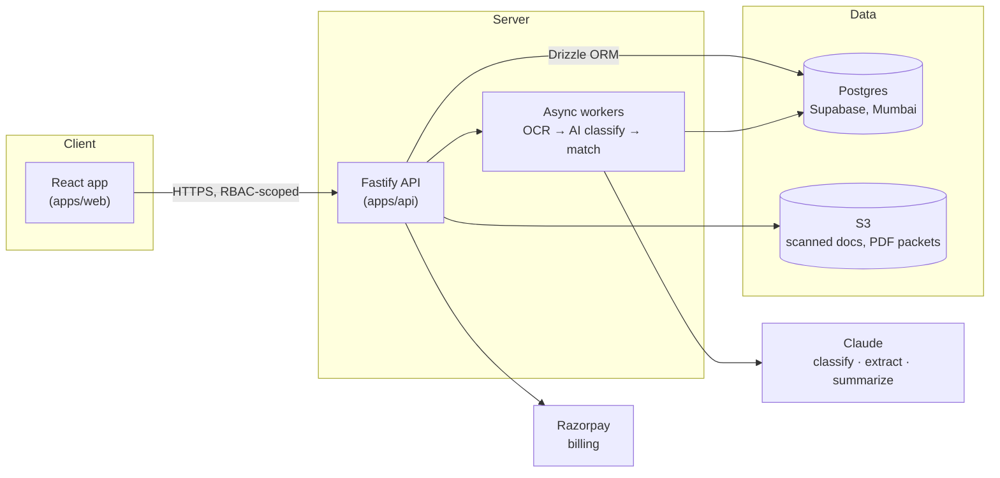

<div align="center">

# ClaimFlow

**Multi-tenant SaaS for hospital insurance claims desks.**

[](https://github.com/Cdineshreddy12/ClaimFlow/actions/workflows/ci.yml)    

[Architecture](docs/ARCHITECTURE.md) · [Decision records](docs/adr) · [Design mockup](docs/design/claims-desk-mockup.html)

</div>

---

## Table of contents

- [The problem](#the-problem)
- [What ClaimFlow does](#what-claimflow-does)
- [Status](#status)
- [Architecture](#architecture)
- [Tech stack](#tech-stack)
- [Repository structure](#repository-structure)
- [Getting started](#getting-started)
- [Database](#database)
- [Scripts](#scripts)
- [Environment variables](#environment-variables)
- [Security model](#security-model)
- [Roadmap](#roadmap)
- [Documentation](#documentation)
- [License](#license)

## The problem

A hospital's insurance desk handles cashless admissions across 20+ insurers
and TPAs, each with its own document format. Today that means typing
pre-authorization forms, scanning doctors' notes, emailing them out,
tracking status in spreadsheets, and chasing queries and doctors over
email and WhatsApp. Hospitals lose money to avoidable deductions —
documents missing at submission, not treatment errors — and patients wait
longer than necessary for discharge approval while the desk tracks
everything by hand.

## What ClaimFlow does

- **One claim file per admission** with a live status timeline (pre-auth →
  query/enhancement → approved → final bill → settled).
- **A checklist of what's missing**, configured per insurer and procedure
  by the hospital's own admin, computed live — never stale.
- **AI-assisted document sorting and field pre-fill** — every AI result
  shows its source and stays unconfirmed until a human clicks it.
  Misclassified documents are draggable to the right slot. Nothing is
  ever sent to an insurer or TPA automatically.
- **A query inbox** that summarizes what a TPA wants and by when, with the
  original email always visible underneath the summary.
- **Multi-tenant from the ground up** — every hospital that signs up is an
  isolated organization on one shared deployment, not a one-off install.

## Status

**Architecture and schema are real and live; feature modules are next.**

- ✅ Multi-tenant Postgres schema, migrated via Drizzle ORM and verified
  against a real Supabase project (10 tables, 20 RLS policies, seeded
  with the pilot tenant's sample data).
- ✅ Workspace scaffold (`apps/web`, `apps/api`, `packages/contracts`)
  typechecks, lints, tests, and builds clean in CI.
- ✅ System architecture and six decision records written for the hard
  calls: the checklist rules engine, tenant isolation, async document
  processing, the claim state machine, AI confirmation UX, and billing.
- ✅ Four of eight core screens have a reviewed, critiqued, and
  accessibility-fixed design mockup.
- ✅ Auth: Supabase JWT verification + a Custom Access Token hook that
  stamps organization_id/role onto the token, RBAC middleware, enforced
  on every claims route.
- ✅ Claims module (API): list/get/create, status transitions enforced
  against the shared state machine, desk_executive scoped to their own
  assigned claims.
- ✅ Checklist module (API): rules CRUD, gated to org_admin/desk_head.
  Claim creation now actually snapshots the live rules onto the claim.
- ✅ Documents module (API): pre-signed S3 upload, human-confirm into a
  checklist slot, discard, and a live gap-view endpoint (required docs
  minus confirmed ones). AI auto-classification isn't wired up yet — no
  provider credentials exist for it (see docs/adr/0003) — so every
  document is confirmed into a slot manually for now.
- ✅ Query inbox module (API): log a TPA query against a claim, an
  org-wide inbox listing (open/replied/all, same desk_executive scoping
  as claims), and reply tracking. No AI summarizer wired up yet either —
  same boundary as documents — so the summary/requested items are
  entered by hand for now; the original email is the source of truth
  either way per docs/adr/0005.
- ✅ Web app: Claim File, Dashboard, and Query Inbox screens wired
  end-to-end against the live API. Claim File has the status timeline,
  live document-gap view, and a real upload flow (the browser PUTs
  straight to S3, same pre-signed-URL path as the API). Dashboard has
  real kpis, a claims-by-status breakdown, and the claims table — two
  of the mockup's kpis (avg discharge wait, deductions by reason) have
  no backing data yet, so they're swapped for real equivalents (avg
  time in stage, open/overdue queries) rather than faked. Query Inbox
  lists open TPA queries with a live reply-window countdown and marks
  a reply sent for real (docs/adr/0005 — nothing is ever auto-sent, and
  no reply body is stored, only the timestamp); whether a requested
  document "looks attached" is a best-effort match against the claim's
  confirmed checklist slots, not a stored fact, since nothing in the
  schema links a query's requested item to a specific document. No
  login screen yet, so a dev-only minted token stands in for auth (see
  `.env.example`'s `VITE_DEV_TOKEN`) — swap for real Supabase auth once
  the Custom Access Token hook is enabled.
- ✅ Audit logging — every mutation that creates, changes or destroys
  tenant data writes a who/what/when entry (DPDP constraint, see
  docs/adr/0009). Deltas only, not row dumps; reads gated to
  org_admin/desk_head; no write route, so the trail can't be forged by
  a client. Not yet transactional with the mutation — caveat in the ADR.
- ✅ Checklist Admin screen — pick an insurer × procedure, add/remove
  document requirements and flip each between required and optional.
  Shows how many in-flight claims the pair has, and states plainly that
  edits apply going forward only (verified: adding a live rule leaves an
  open claim's frozen snapshot untouched).

All of the above is covered by both unit tests and integration tests
against the real Supabase database and the real S3 bucket — not mocked.

## Architecture



Every tenant-scoped table carries `organization_id`. Tenant isolation is
enforced in the Fastify route layer, not by database RLS — see
[Security model](#security-model) for exactly why, and
[`docs/adr/0002`](docs/adr/0002-authorization-and-tenant-isolation.md) for
the full reasoning.

## Tech stack

| Layer        | Choice                                                                                    | Why                                                                                      |
| ------------ | ----------------------------------------------------------------------------------------- | ---------------------------------------------------------------------------------------- |
| Frontend     | React · Vite · TypeScript · Tailwind · Zustand (UI state) · TanStack Query (server state) | Fast to build a clean UI; server-state caching stays out of the client-state store       |
| Backend      | Fastify (Node.js, TypeScript)                                                             | Lightweight, plugin-based, a natural fit for a module-per-domain API                     |
| ORM          | Drizzle ORM + drizzle-kit                                                                 | Type-safe schema, queries, and migrations, generated from one TypeScript source of truth |
| Database     | Supabase-hosted Postgres (Mumbai region)                                                  | DPDP-compliant residency; managed hosting                                                |
| File storage | AWS S3 (Mumbai region)                                                                    | Scanned documents and merged PDF packets never live in the database                      |
| AI           | Claude — classification, field extraction, query summarization                            | Structured extraction with citations maps directly to the human-confirm requirement      |
| Billing      | Razorpay Subscriptions                                                                    | GST-compliant invoicing for Indian hospital finance teams                                |

Full rationale for each decision is in [`docs/adr/`](docs/adr).

## Repository structure

```
apps/
  web/            React app — feature-based (src/features/*)
  api/            Fastify app
    src/modules/      Domain modules (claims, checklist, documents, queries, auth, audit)
    src/workers/      Async document processing
    src/integrations/ External services (storage, ocr, ai, email)
    src/db/           Drizzle schema, migrations, seed
packages/
  contracts/      Zod schemas shared by both apps — API shapes, not DB models
supabase/         Auth/Studio config for local dev (schema lives in apps/api/src/db/)
docs/
  ARCHITECTURE.md
  adr/            Decision records for the hard calls
  design/         Reviewed UI mockup
```

## Getting started

```bash
pnpm install
cp .env.example .env   # fill in Supabase / S3 / Anthropic / Razorpay keys
pnpm dev                # runs apps/web and apps/api together
```

## Database

Schema lives in `apps/api/src/db/schema.ts`; migrations in
`apps/api/src/db/migrations/`.

```bash
cd apps/api
pnpm db:generate   # generate a migration from schema.ts changes
pnpm db:migrate    # apply pending migrations
pnpm db:seed       # seed the pilot tenant's sample claims
pnpm db:studio     # browse the database
```

## Scripts

| Script           | What it does                |
| ---------------- | --------------------------- |
| `pnpm dev`       | Run all apps in dev mode    |
| `pnpm build`     | Build all apps and packages |
| `pnpm lint`      | Lint the whole workspace    |
| `pnpm typecheck` | Typecheck all workspaces    |
| `pnpm test`      | Run all test suites         |

## Environment variables

See [`.env.example`](.env.example) for the full list with explanations.
Summary:

| Variable                             | Used by            | Notes                                                         |
| ------------------------------------ | ------------------ | ------------------------------------------------------------- |
| `DATABASE_URL`                       | Drizzle (apps/api) | Direct Postgres connection — bypasses RLS, see Security model |
| `SUPABASE_URL` / `SUPABASE_ANON_KEY` | apps/web, apps/api | Auth                                                          |
| `SUPABASE_SERVICE_ROLE_KEY`          | apps/api           | Admin tooling only — also bypasses RLS                        |
| `AWS_*`                              | apps/api           | S3 storage, Textract OCR                                      |
| `ANTHROPIC_API_KEY`                  | apps/api           | Claude — classification, extraction, summarization            |

## Security model

Patient records are sensitive personal data under India's DPDP Act 2023.
Two things worth stating plainly rather than leaving implicit:

- **RLS policies exist in the schema but do not protect the API.** The API
  connects to Postgres via Drizzle as the `postgres` superuser, and
  Postgres superusers bypass Row-Level Security unconditionally — this is
  documented Postgres behavior, not an oversight. **Fastify RBAC is the
  enforced tenant boundary** for every request; every tenant-scoped query
  in `apps/api/src/modules/*` must filter by `organization_id` explicitly.
  Full detail: [`docs/adr/0002`](docs/adr/0002-authorization-and-tenant-isolation.md).
- **Checklist rules are versioned.** Editing a hospital's checklist only
  affects claims opened after the edit — an in-flight claim's requirements
  never shift underneath the desk executive working it.
  [`docs/adr/0001`](docs/adr/0001-checklist-engine.md).

## Roadmap

- [x] Auth (Supabase JWT + RBAC), claims, checklist, documents, and
      query-inbox modules (API)
- [x] Dashboard, Claim File, and Query Inbox screens (web) — wired to
      the live API, not just styled
- [x] Checklist Admin screen (web) — all four mockup screens now built
- [ ] AI document classification, OCR, and query summarization (pending
      provider credentials)
- [ ] Doctor approval via phone link
- [ ] Merged PDF packet per TPA
- [ ] Self-serve organization signup + 14-day trial + Razorpay billing —
      flow designed in [`docs/adr/0007`](docs/adr/0007-onboarding-flow.md),
      not yet built; needs the Supabase Custom Access Token Hook enabled
      in the dashboard before it can work end-to-end
- [ ] Platform super-admin console with audited break-glass access

## Documentation

- [`docs/ARCHITECTURE.md`](docs/ARCHITECTURE.md) — system overview, stack, module map
- [`docs/adr/`](docs/adr) — decision records (checklist engine, tenant isolation, document pipeline, claim state machine, AI confirmation UX, billing, onboarding flow, audit logging)
- [`docs/design/claims-desk-mockup.html`](docs/design/claims-desk-mockup.html) — reviewed UI reference

## License

Proprietary — all rights reserved. Not licensed for reuse, redistribution,
or modification outside this project.
